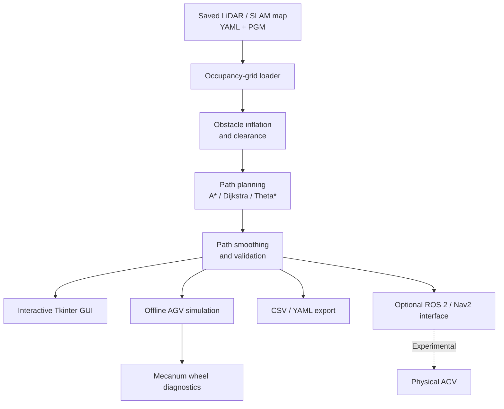

# AGV LiDAR Path Planner

[](https://github.com/Aminniii/agv-lidar-path-planner/actions/workflows/tests.yml)


[](LICENSE)

A Python desktop application for **LiDAR occupancy-grid path planning,
route visualization and mecanum AGV simulation**, with optional,
experimental ROS 2/Nav2 integration.

Developed as a robotics and autonomous navigation engineering project.

## Features

- **Pathfinding:** A*, Dijkstra and Theta*
- **Map loading:** ROS occupancy-grid YAML and PGM files
- **Interactive GUI:** Tkinter-based map visualization, zoom and pan
- **Route planning:** Start, goal and multiple stops
- **Obstacle clearance:** Configurable inflation and collision-aware smoothing
- **Simulation:** Virtual robot movement and mecanum wheel diagnostics
- **Proximity visualization:** Obstacle zones and simulated footprint collision checks
- **Exports:** CSV/YAML route data
- **ROS 2/Nav2:** Optional experimental integration

## Quick start

### Requirements

- Ubuntu Linux with Python 3.11–3.13 recommended
- Tkinter and Python virtual environment support
- ROS 2 is **not required** for offline operation

```bash
sudo apt install python3-tk python3-venv

git clone https://github.com/Aminniii/agv-lidar-path-planner.git
cd agv-lidar-path-planner

python3 -m venv .venv
source .venv/bin/activate
python -m pip install -e .

agv-path-planner
```

### First route

1. Start the application.
2. Select **Load Map**.
3. Open `examples/demo_map.yaml`.
4. Choose a start position and destination.
5. Select a planning algorithm and calculate the route.
6. Inspect the path and run the offline simulation.
7. Export the route when needed.

Real ROS maps normally consist of a `.yaml` metadata file and
an associated `.pgm` occupancy image.

## System architecture



The architecture distinguishes the tested offline planner from
experimental hardware integration. The desktop application is not
a real-time obstacle-avoidance or emergency-stop system.

See [Architecture](docs/ARCHITECTURE.md) for details.

## Compatibility

| Component | Status |
|---|---|
| Ubuntu Linux | Offline application exercised |
| Python 3.11 | GitHub Actions test environment |
| Python 3.12 | GitHub Actions test environment |
| Python 3.13 | GitHub Actions test environment |
| Python 3.14 | Used in development; not part of CI matrix |
| Windows / macOS | Not verified |
| ROS 2 Lyrical | Development environment; integration experimental |
| ROS 2 Jazzy | Robot-side environment; end-to-end integration unverified |
| Raspberry Pi + Arduino Mega | Hardware integration not validated by CI |
| Nav2 real-robot execution | Experimental |

The CI matrix verifies offline tests and package installation;
it does not validate GUI interaction or robot hardware.

## Configuration

Default robot configuration:

`src/agv_planner/config/robot_config.yaml`

To use another configuration file:

```bash
export AGV_CONFIG_FILE=/absolute/path/robot_config.yaml
agv-path-planner
```

Confirm actual robot dimensions and map resolution before planning.

## Safety and limitations

**This software is not a certified robot safety system.**

- The orange proximity ring is a visualization, not a physical collision boundary.
- The offline simulator performs footprint checks against the loaded map.
- A conservative footprint-clearance check is applied before Nav2 path export.
- Localization error, map inaccuracies and moving obstacles remain possible.
- Real-robot motion requires separate safety controls and supervision.
- Large maps may cause GUI pauses because planning runs on the Tkinter thread.

For a 0.34 m × 0.30 m footprint, the circumscribed radius is
approximately 0.227 m. A clearance of 0.20 m is not sufficient for
that conservative circular-footprint check.

## Development and testing

```bash
python -m pip install -e '.[dev]'

PYTEST_DISABLE_PLUGIN_AUTOLOAD=1 python -m pytest -q

PYTEST_DISABLE_PLUGIN_AUTOLOAD=1 python -m pytest \
    --cov=agv_planner \
    --cov-report=term-missing \
    --cov-report=html
```

The HTML coverage report is generated in `htmlcov/index.html`.

Coverage reports show which Python lines are exercised by tests.
They do not establish physical robot safety.

## Documentation

- [Architecture](docs/ARCHITECTURE.md)
- [ROS 2 setup](docs/ROS_SETUP.md)
- [Dependencies](docs/DEPENDENCIES.md)
- [Release checklist](docs/RELEASE_CHECKLIST.md)
- [Roadmap](docs/ROADMAP.md)
- [Contributing](CONTRIBUTING.md)
- [Changelog](CHANGELOG.md)

## License

MIT License — Copyright (c) 2026 Andrei Dobrescu.

See [LICENSE](LICENSE).
