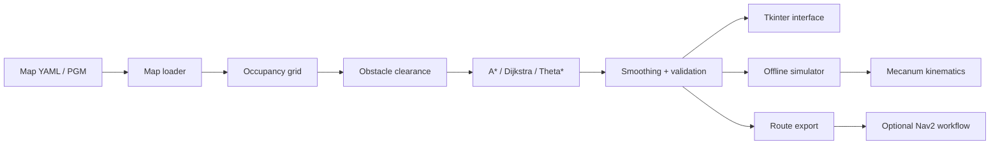
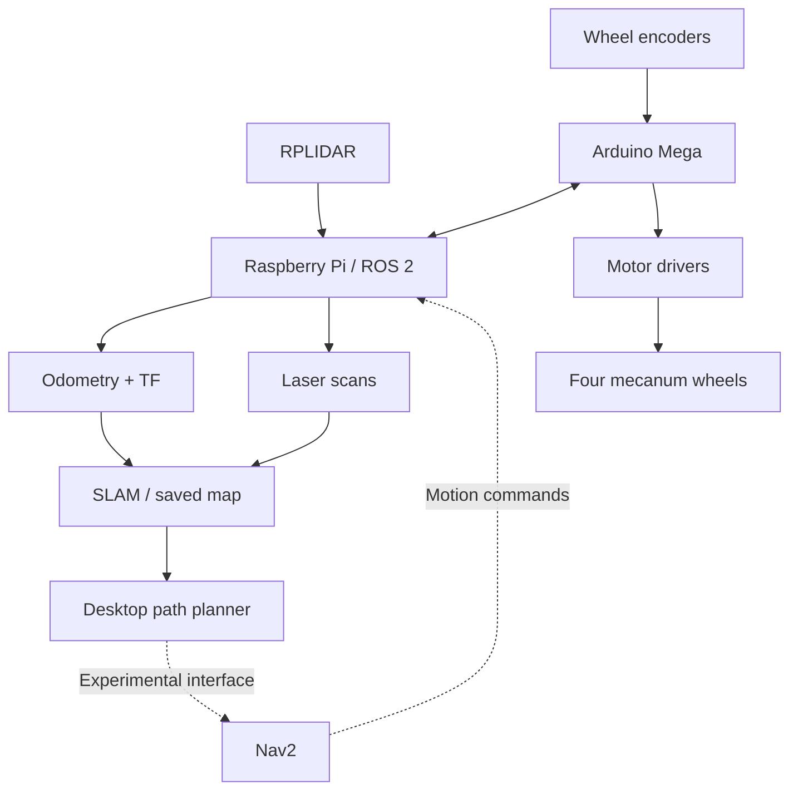

# Software Architecture

## Overview

The application provides offline path planning from a saved ROS
occupancy-grid map, with an optional ROS 2/Nav2 interface.

## Source layout

| Module | Responsibility |
|---|---|
| `src/agv_planner/planner.py` | Main application entry point and GUI logic |
| `src/agv_planner/core.py` | Shared planning functionality |
| `src/agv_planner/maps/` | Occupancy-grid processing |
| `src/agv_planner/planning/` | Algorithms, proximity and safety |
| `src/agv_planner/simulation/` | Robot and wheel simulation |
| `src/agv_planner/ros/` | ROS-related support |
| `src/agv_planner/config/` | Robot configuration |
| `tests/` | Automated offline tests |

## Robot system context

The wider robotics project uses a Raspberry Pi, Arduino Mega,
four mecanum wheels, encoders and RPLIDAR.

The desktop planner is separate from the motor controller.

This diagram represents the intended system-level integration.
It is not proof of end-to-end Nav2 operation.

## Safety boundary

Map-based planning and offline collision prediction do not replace
hardware emergency stops, live sensing, localization validation,
or supervised robot testing.
